# Exercise 03 — Solution: Retriever ownership contract for a specific team

This is a reference solution for `exercise-03-role-scope-and-ownership-contract-with-peers.md`.
Deliverables A, B, C are worked below against the scenario the exercise prescribes (mid-size B2B
SaaS, four corpora, two product teams, one eval team, one MLOps team, one legal team, one hire —
you).

## 1. Solution overview

The exercise is a *writing* exercise, not an implementation. The three artifacts the learner
produces are evaluated on scope discipline, not on code. We provide:

- **Deliverable A** — a filled-in `retriever-ownership-contract.md` that fits the ≤ 1.5-page
  budget and uses chapter 4's template verbatim.
- **Deliverable B** — three "not us" notes under 250 words each, one per capability most often
  misattributed to a retrieval engineer in this scenario.
- **Deliverable C** — a Mermaid delegation diagram in text (which also exports to an image via
  tooling the learner is free to pick) with every arrow labeled by the artifact crossing it, not
  just the team name.

Scope discipline is the grading axis. A learner who writes a long, thorough contract that
accidentally pulls faithfulness measurement into their scope has failed the exercise. A learner
whose contract is shorter but names the right four delegation lines has passed.

## 2. Worked answer or implementation

### Deliverable A — `retriever-ownership-contract.md`

> Fits within 1.5 pages when rendered as Markdown with default margins. Every quality / latency /
> cost / freshness number is a `TBD` placeholder linked to the module that will produce it. Do
> not strip the placeholder — the discipline of writing a contract *before* the numbers exist is
> the pattern the exercise asks for.

```markdown
## Retriever ownership contract — v1

Owned by: retrieval-engineering (one engineer, newly hired — "you")
Consumers:
  - Product team A — "Ask Docs" (two application developers): consumes the retriever
    for the public-docs corpus today and will consume it for internal Confluence and
    Google Drive once the permission-aware version ships.
  - Product team B — "Support Copilot" (three engineers): consumes the retriever
    as an MCP-compatible tool from the support-agent copilot loop.

The retriever this team ships:
  - Interface:
      • MCP tool `retriever.search` — JSON tool schema with inputs
        `{ query: string, top_k: int, filters: { tenant_id: string, corpus: enum,
        updated_since?: iso-8601 } }` and output
        `{ hits: [{ chunk_id, doc_id, source_url, section_path, page?, text, score }] }`.
        Implementation details in mod-110.
      • Supporting HTTP endpoint `POST /search` with the same schema for non-agent
        callers (Ask Docs today).
  - Quality claim:
      recall@10 = TBD, target ≥ 0.85 on judgment-set-v1 (produced in mod-109);
      paired-significance p < 0.05 vs. previous version on each release.
  - Latency claim:
      p50 = TBD, p95 = TBD measured under the "Support Copilot steady-state"
      workload (details in mod-104 after ANN tuning + mod-111 after cache tiering).
  - Cost claim:
      $TBD per 1M queries at current cache hit ratio TBD% (mod-111 produces the
      measured baseline).
  - Freshness claim:
      corpus lag ≤ 6 hours per corpus; ingestion DAG with per-corpus backfill and
      lag SLO (mod-111). Confluence and Google Drive ACL changes propagate within
      ≤ 15 minutes.
  - Permission claim:
      per-tenant isolation via pre-filtered retrieval on `tenant_id`; Confluence
      and Google Drive ACL is mirrored into the index at ingest and enforced as a
      pre-filter before ANN scoring (mod-112). SFDC ticket corpus enforces
      per-account ACL on the same mechanism.

Not this team's scope; delegated to:
  - Product-surface prompt shape / "answer with citations" UX / citation rendering →
    `applied-ai-engineer` (level 30, AI Engineering family) — Product team A owns the
    Ask Docs product surface; Product team B owns the Support Copilot product surface.
  - Application-layer RAG-triad (faithfulness, answer relevance, context precision-
    recall at the product layer) + LangSmith/Langfuse tracing → `ai-eval-engineer`
    (level 30) — the AI Evaluation team in this scenario.
  - Generic CI/CD-for-ML, model registry, embedding model-serving infrastructure →
    `ai-infra-mlops` (level 25) — the ML Platform / MLOps team in this scenario.
  - Content-safety methodology, PII detection, jailbreak evaluation → `ai-risk-engineer`
    (level 25, Governance family); Legal / Compliance is the stakeholder.
  - Embedding fine-tuning (sentence-transformers SFT, LoRA, PEFT) → `fine-tuning-
    engineer` (level 30, ML family) — not currently staffed here; a brief is produced
    if mod-103's selection benchmark says "best off-the-shelf is still X points
    short."
  - Agent-loop design, when to call the retriever twice vs. once, how to interleave
    rewrite / retrieve / answer → `agentic-ai-engineer` (level 40) — the Support
    Copilot team owns the agent decisions above the MCP tool we expose.
  - Platform-scale serving (GPU-accelerated ANN, sharded cross-DC replication, HA) →
    `ai-infra-senior-engineer` (level 40) — not yet relevant at this scale; will be
    the escalation path once corpus or QPS cross thresholds mod-111 names.

Escalation triggers (we own, but pull the delegated party in):
  1. Retrieval-quality regression discovered in production through a complaint, *not*
     through the judgment-set eval → pull in AI Evaluation team; handed artifact:
     the RAG-triad instrumentation gap at the application layer that hid it, plus
     the queries that failed to find a nearest-neighbour judgment.
  2. Embedding candidate set exhausted (we have benchmarked ≥ 5 off-the-shelf
     models under identical chunker + retriever conditions and the best is still
     below the target recall@k) → pull in a fine-tuning engineer; handed artifact:
     corpus statistics, current best model, target metric, hard-query sample.
  3. A new corpus source arrives with a fundamentally different ACL model — e.g.
     per-row row-level security, attribute-based access rather than group-based →
     pull in `ai-risk-engineer` + Legal; handed artifact: the ACL mechanism we
     propose for the new corpus and the tenant-isolation test plan.
  4. SFDC retrieval requires exposing fields that could contain customer PII in
     retrieved chunks → pull in `ai-risk-engineer` + Legal; handed artifact: a
     PII inventory of the corpus and a proposed redaction pipeline.
  5. Agent orchestration consistently calls the retriever more than N times per
     turn and the cost/latency blows past budget → pull in `agentic-ai-engineer`
     (Support Copilot team); handed artifact: per-turn tool-call trace and cost
     breakdown, with the recommendation of which calls are genuinely needed.
```

### Deliverable B — three "not us" notes

File name: `not-us-notes.md`. Each note is under 250 words and is collaborative, not defensive.

```markdown
# Not-us notes — retrieval-engineering boundary with Product A, AI Eval, and Support Copilot

---

## Note 1 — to Product team A (Ask Docs), on the "answer with citations" prompt and
citation UI

Hi team —

Thanks for naming the citation-rendering problem; it is the right next step for
Ask Docs. It is not, however, in the retriever's scope: the retriever's job is to
give you back a short list of chunks with stable anchors (`chunk_id`, `source_url`,
`section_path`, `page`), a quality claim on recall@10, a latency claim, and a cost
claim. What the generator does with those anchors and how the UI renders them to the
user are decisions that sit in the `applied-ai-engineer` role — i.e. you.

What I *do* own at the boundary: mod-108 in my track covers the retrieval-specific
prompt slice — the citation-forcing shape, the refusal policy when context is
insufficient, and the post-generation citation-verification check that catches
fabricated chunk IDs. I will ship you a reference prompt snippet and a
citation-verifier function you can plug into your generator call. Everything above
that — the HTML rendering, the hover-cards, the "did you find this useful?" feedback
loop — is yours to design. Shout if you want a design review before you ship the
citation UX.

Deliverables at the boundary:
  - The MCP tool schema and endpoint spec (owned by me).
  - A citation-forcing prompt snippet + verifier (owned by me, mod-108).
  - The citation-rendering design and the "insufficient information" fallback copy
    (owned by Ask Docs + applied-ai-engineer).

---

## Note 2 — to Product team A (Ask Docs), on faithfulness / answer-relevance measurement

Hi team —

Faithfulness and answer-relevance measurement on the Ask Docs *answers* is not in
my team's scope — those are the RAG-triad metrics at the application layer, owned
by the AI Evaluation team (`ai-eval-engineer`, level 30). RAGAS, TruLens, and
DeepEval are their tools; LangSmith / Langfuse tracing is their rails. I will not
duplicate that work in the retriever.

What my team *does* own at the boundary: retrieval-only evaluation (mod-109 in my
track) — a judgment set that maps queries to relevant-doc-IDs on the public-docs,
Confluence, Drive, and SFDC corpora; recall@k, precision@k, MRR, nDCG@k; and
paired significance tests on every retrieval-affecting PR. I will share the
judgment set, the eval runbook, and the per-release retrieval-quality report with
the AI Evaluation team so their faithfulness numbers can attribute cleanly: if
faithfulness is low but retrieval recall is fine, the fix is in the generator or
the assembly; if retrieval recall is low, it is mine.

Deliverables at the boundary:
  - Judgment set v1 and retrieval-only eval report per release (owned by me).
  - RAG-triad instrumentation and the application-layer eval dashboard (owned by
    AI Evaluation).

Happy to walk through the retrieval-only metrics with your lead so you can see which
regressions will page which team.

---

## Note 3 — to Support Copilot, on the agent loop that decides when to call the
retriever twice

Hi team —

The question "when should the agent call the retriever twice vs. once" is a
decision in the *agent* loop, not a decision in the *retriever*. It sits in the
`agentic-ai-engineer` role (level 40). My team provides a retriever that the agent
can call as many times as it likes, with a stable MCP tool schema and a published
latency + cost claim — the agent's planning logic on top of that interface is yours.

What my team *does* own at the boundary: mod-110 in my track exposes the tuned
retriever as an MCP-compatible tool with the schema in the ownership contract. I
will publish and version that schema, provide a latency and cost claim per corpus,
and support the tool's behaviour on-call. If the agent is calling the retriever
a surprising number of times per turn and our cost budget becomes a problem, I
will flag it, hand you the trace, and we will look at it together — but the fix
is usually in the planning policy, not in the retriever.

Deliverables at the boundary:
  - MCP tool schema + support contract (owned by me, mod-110).
  - Agent planning / step-planning / call-the-tool-twice policy (owned by Support
    Copilot + agentic-ai-engineer).
```

### Deliverable C — delegation diagram

Mermaid source saved as `delegation-diagram.md`. Every arrow is labeled by the *artifact* moving
across it, not just the team name.

```mermaid
graph TD
    %% Center — you
    YOU["<b>retrieval-engineering</b><br/>(you, one engineer)"]

    %% Peer teams (sideways)
    APPLIED["<b>applied-ai-engineer</b><br/>(Product A + B product surfaces)"]
    AIEVAL["<b>ai-eval-engineer</b><br/>(AI Evaluation team)"]
    MLOPS["<b>ai-infra-mlops</b><br/>(ML Platform team)"]
    RISK["<b>ai-risk-engineer</b><br/>(+ Legal / Compliance)"]
    FT["<b>fine-tuning-engineer</b><br/>(not yet staffed)"]

    %% Higher roles (upward)
    AGENT["<b>agentic-ai-engineer</b><br/>(Support Copilot agent loop)"]
    INFRA["<b>ai-infra-senior-engineer</b><br/>(future — platform-scale serving)"]

    %% Lower prerequisites (downward)
    APPDEV["llm-application-developer<br/>(level 20 — retrieval basics, FastAPI)"]
    MLE["ml-engineer<br/>(level 20 — BM25/tf-idf primer, HF/PyTorch)"]
    INFRA_JR["ai-infra-junior-engineer<br/>(level 10 — Linux, Git, Docker, Python)"]

    %% Sideways — outgoing (I deliver → peer)
    YOU -- "retriever MCP tool schema + support contract" --> APPLIED
    YOU -- "judgment set v1 + retrieval-only eval report" --> AIEVAL
    YOU -- "retriever-CI gate + retrieval-metric drift alerts" --> MLOPS
    YOU -- "ACL mechanism per corpus + tenant-isolation test plan" --> RISK
    YOU -- "selection-benchmark brief (when candidates exhausted)" --> FT

    %% Sideways — incoming (peer delivers → me)
    APPLIED -. "feature-flag rollout telemetry + product-layer bug reports" .-> YOU
    AIEVAL  -. "RAG-triad findings (faithfulness / answer-rel)" .-> YOU
    MLOPS   -. "model registry + CI/CD infrastructure" .-> YOU
    RISK    -. "PII inventory + content-safety methodology" .-> YOU
    FT      -. "fine-tuned embedding artifact + eval report" .-> YOU

    %% Upward — outgoing to higher roles
    YOU -- "MCP tool schema + latency/cost claim" --> AGENT
    YOU -- "platform-scale serving brief (future)" --> INFRA

    %% Downward — consumed prerequisites
    APPDEV  -- "retrieval basics, prompt eng., FastAPI" --> YOU
    MLE     -- "classical IR / tf-idf / BM25 fundamentals" --> YOU
    INFRA_JR -- "engineering craft (Linux, Git, Docker, Python)" --> YOU
```



If Mermaid rendering is unavailable, the same diagram is acceptable as a `.png` export from
tldraw / Excalidraw / diagrams.net. The requirement is that every arrow has an artifact label.

## 3. Validation steps

1. Count pages — Deliverable A must render to at most 1.5 pages at default Markdown margins (12 pt
   body font, 1-inch margins, single-column). Pass/fail is strict.
2. Re-read Deliverable A and tally the four required sub-sections of chapter 4's template:
   (1) Owned by / Consumers, (2) The retriever this team ships, (3) Not this team's scope;
   delegated to, (4) Escalation triggers. Any missing section fails.
3. Check that every `TBD` or placeholder number in Deliverable A has a linked module (`mod-109`,
   `mod-111`, etc.). A bare `TBD` with no module reference is treated as "we have not thought
   about where this number comes from" — a review-and-return.
4. Open Deliverable B. Each note must explicitly name (a) which peer role it is deferring to, (b)
   which module in this track covers the adjacent capability, and (c) what the retrieval engineer
   *will* deliver at the boundary. A note that only names the delegation ("not us, talk to X")
   and does not name the adjacent deliverable fails scope-discipline review.
5. Open Deliverable C. Every arrow must have a label that is an *artifact*, not just a team name
   or a direction. "MCP tool schema" is an artifact; "retriever" is not; "to AI Eval" is a
   direction, not an artifact.
6. Word-count each note in Deliverable B. Any note above 250 words fails the discipline (the
   constraint is what forces the collaborative tone).

## 4. Rubric or review checklist

| Axis | Pass criterion |
|---|---|
| Deliverable A length | ≤ 1.5 pages rendered |
| Deliverable A sections | All four sub-sections present with concrete team names from the scenario |
| Deliverable A placeholders | Every TBD links to a module that will produce the number |
| Deliverable A escalation triggers | At least four, each with observation + peer pulled in + artifact handed over |
| Deliverable B notes count | Three notes, one per listed capability |
| Deliverable B note length | Each ≤ 250 words |
| Deliverable B note structure | Each names (a) delegated role, (b) adjacent module, (c) boundary deliverable |
| Deliverable B tone | Collaborative, not defensive — scored on a reviewer gut-check, not a regex |
| Deliverable C arrows | Every arrow labeled with an artifact (not a team name, not a direction) |
| Deliverable C coverage | At least five peer teams reachable; at least two upward roles; at least two downward prerequisite tracks |

Fail-fast smells (any one means "revise and resubmit"):

- The contract says you own faithfulness or answer-relevance measurement.
- The contract says the retrieval engineer designs the Support Copilot agent loop.
- A note under Deliverable B blames the peer team rather than naming the boundary.
- The diagram has an arrow but no artifact label.

## 5. Common mistakes

- **Pulling faithfulness into the retriever's scope.** The single most common failure of this
  exercise. "Faithfulness" and "answer relevance" are application-layer RAG-triad metrics owned
  by `ai-eval-engineer`, not by the retriever. The retriever owns recall@k / MRR / nDCG@k / paired
  significance — the metrics in mod-109.
- **Writing a RACI matrix instead of a contract.** A RACI is a nine-column spreadsheet; a
  contract is a one-pager that lets a new peer know where they can push back. The template in
  chapter 4 is a contract — four sub-sections, concrete team names, numbers with placeholders.
- **Skipping the quality / latency / cost / freshness / permission *claims* because the numbers
  do not exist yet.** The numbers are supposed to be `TBD` linked to modules that will produce
  them. The discipline of writing the slots down before the numbers is the whole point.
- **Writing escalation triggers as "if anything goes wrong, pull in X."** The template asks for
  the observation, the peer, and the artifact handed over. A vague trigger is not operational.
- **Writing the agent-loop decision into the retriever's scope because "the agent is calling my
  retriever."** The agent calling your retriever is the interface — the planning logic on top of
  that interface is `agentic-ai-engineer`. The MCP schema is yours; the loop is theirs.
- **Over-indexing on security / Legal.** Legal and `ai-risk-engineer` are consulted on ACL and
  PII, but they do not *own* the retriever's design. Writing "Legal signs off on every release"
  is wrong — Legal signs off on *the ACL model and the PII inventory*, not on every retrieval
  change.
- **The diagram labeling arrows with team names instead of artifacts.** "To AI Eval" is not an
  artifact. "Judgment set v1 + retrieval-only eval report" is.
- **Writing the small-team stretch-goal reflection without actually collapsing the contract.**
  The two-person-startup version does collapse several delegations into "same person wearing two
  hats." The reflection is about *which parts of the contract remain load-bearing even when the
  same person owns both sides of the boundary* — typically the escalation triggers and the
  index-versioning contract with the MLOps team, because those exist to coordinate with Future
  You.

## 6. References

- Lesson sources in this module:
  - `lessons/mod-101-retrieval-engineering-foundations/03-retrieval-as-feature-vs-engineered-system.md`
    — the feature-shape vs. engineered-system-shape framing used throughout the contract.
  - `lessons/mod-101-retrieval-engineering-foundations/04-role-position-on-the-ladder.md` — the
    ownership-contract template reproduced verbatim in Deliverable A, and the level-ladder used
    for peer naming (`applied-ai-engineer`, `ai-eval-engineer`, `fine-tuning-engineer`,
    `ai-risk-engineer`, `ai-infra-mlops`, `agentic-ai-engineer`, `ai-infra-senior-engineer`).
- The track root `CURRICULUM.md` section *Ownership rule* (referenced by chapter 4) — the
  canonical statement of the deferral graph used in Deliverable C.
- The track root `PREREQUISITES.md` section *Not in scope for this track (linked out)* — the
  shorter version of the delegation contract that Deliverable B leans on when naming adjacent
  modules.
- Gao, Y., et al. (2024). *Retrieval-Augmented Generation for Large Language Models: A Survey.*
  v5. [arXiv:2312.10997](https://arxiv.org/abs/2312.10997) — cited by chapter 3 for the
  Advanced / Modular RAG framing that the engineered-system shape maps onto.
